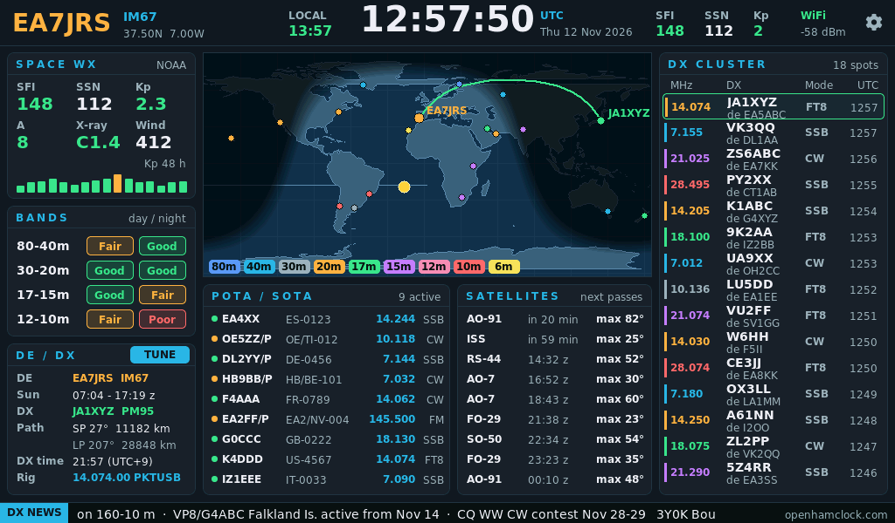

# Reloj con los datos de OpenHamClock (entorno `waveshare_lcd7b_hamclock`)

La Waveshare ESP32-S3-Touch-LCD-7B (1024×600) como reloj de radioaficionado. Es solo para la 7B: la LCD-7 (sin B, 800×480)
no lo lleva. Los datos son los de un servidor
[OpenHamClock](https://github.com/accius/openhamclock) (MIT, K0CJH): [openhamclock.com](https://openhamclock.com) o uno propio.
OpenHamClock es una aplicación web (React + Node) y no cabe en un ESP32: aquí la interfaz está hecha de nuevo en LVGL y la placa
solo pide por WiFi el JSON de su API. No usa el enlace BLE con el tracker.



## Qué enseña
- **Cabecera**: indicativo, locator, hora UTC y local, SFI / SSN / Kp, WiFi y la rueda de los ajustes.
- **Space WX**: SFI, SSN, Kp, A, rayos X, viento solar y las últimas 48 h de Kp. **Bands**: condiciones de día y de noche (N0NBH).
- **Mapa**: la noche, el sol, los spots con el color de su banda y la ortodrómica hasta el DX elegido.
- **DX cluster**: los 15 spots más nuevos. Al tocar uno pasa a ser el DX: rumbo y distancia por el camino corto y el largo, y su hora.
- **POTA / SOTA** (verde POTA, ámbar SOTA) y **Satellites**: próximos pases de más de 10° calculados en la placa.
- **CAT** (si se pone en los ajustes): en la tarjeta DE / DX, la frecuencia y el modo de la radio; **TUNE** la lleva al spot o a la
  activación POTA / SOTA que se haya tocado.
- **DX news** en el pie; a su derecha, el servidor o el último error de red.

## Ajustes
La rueda (o el primer arranque, sin WiFi guardada) abre los ajustes con teclado: indicativo, locator (4 o 6 caracteres), zona
horaria POSIX (de serie la de la península), red y clave WiFi y dirección del servidor (`https://openhamclock.com` o, por
ejemplo, `http://192.168.1.50:3000`). **Save** guarda (Preferences `hamclock`) y reinicia.

## CAT con Hamlib
Hamlib no cabe en el ESP32: la radio se conecta a un PC o una Raspberry Pi con `rigctld` (el servidor de Hamlib) y la pantalla le
habla por WiFi con su protocolo de texto, igual que el rotor con `rotctld`. Por ejemplo, para un IC-7300 por USB:

```sh
rigctld -m 3073 -r /dev/ttyUSB0 -s 115200 -t 4532      # el numero de modelo de cada radio: rigctl -l
```

En los ajustes, **Radio CAT** lleva la dirección de ese equipo (`192.168.1.50` o `192.168.1.50:4532`); vacío, sin radio. La
pantalla lee frecuencia y modo cada 1,5 s. Tocar un spot o una activación solo lo elige; la radio no se mueve hasta pulsar
**TUNE**. Modo que se manda: CW; SSB como LSB por debajo de 10 MHz (USB en 60 m) y USB por encima; FT8, FT4 y demás digitales
como PKTUSB (USB si la radio no lo tiene); sin modo conocido, solo la frecuencia. `rigctld` no pide contraseña: que esté solo en
la red de casa.

## Datos que pide
| Ruta de la API | Cada | Para |
| --- | --- | --- |
| `/api/dxcluster/paths` | 1 min | DX cluster y mapa |
| `/api/pota/spots`, `/api/sota/spots` | 2 y 3 min | POTA / SOTA |
| `/api/solar-indices` | 10 min | SFI, SSN, Kp y su historia |
| `/api/n0nbh` | 30 min | A, rayos X, viento solar, bandas |
| `/api/dxnews` | 30 min | noticias |
| `/api/satellites/data` | 6 h | elementos orbitales (OMM) |

La hora llega por NTP. Si una petición falla se reintenta al minuto y en pantalla se queda lo último que llegó. HTTPS va sin
comprobar el certificado (datos públicos de solo lectura).

## Código
`src/hamclock/`: `hc_model.*` (modelo, lectura del JSON, sol, rumbos, pases; C++ puro), `hc_map.*` y `hc_land.cpp` (mapa de 512×256;
la máscara de tierra sale de Natural Earth con `tools/make_hamclock_map.py`), `hc_ui.*` (LVGL), `hc_rig.*` (cliente de rigctld, C++ puro), `hc_net.*` (WiFi, peticiones y la tarea del CAT),
`hc_main.cpp`. Placa y letras: las del Display.

Los pases usan un propagador de Kepler con las derivas de J2, no SGP4: con elementos de dos días la diferencia con SGP4 es de
hasta 30 s en el AOS y 2° en la elevación máxima (`tools/hamclock_sim/check_passes.py`).

## Probar en el PC
```sh
g++ -std=c++17 -I src/hamclock -I <ArduinoJson>/src test/test_hamclock.cpp src/hamclock/hc_model.cpp -o /tmp/test_hamclock && /tmp/test_hamclock
rigctld -m 1 -t 4532 &        # la radio de pega de Hamlib
g++ -std=c++17 -I src/hamclock test/test_rig.cpp src/hamclock/hc_rig.cpp -o /tmp/test_rig && /tmp/test_rig 127.0.0.1 4532
tools/hamclock_sim/build.sh <lvgl 9.6> <ArduinoJson>/src      # la interfaz de verdad con datos de ejemplo: PNG en /tmp/hamclock_sim
```

## Estado
Publicado en el instalador web (grupo Display, placa `waveshare_lcd7b_hamclock`) desde la 5.4.3 para probarlo. Sin probar todavía en
una 7B ni contra un servidor de verdad: el formato del JSON está sacado del código de OpenHamClock
(`server/routes`, noviembre de 2026). El CAT está probado en el PC contra `rigctld` 4.5.5 con la radio de pega, no con una radio.
